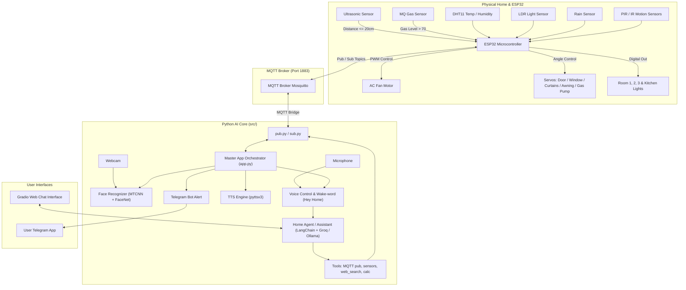

# Future Home AI (Homey)

<div align="center">

[](https://www.python.org/)
[](https://pytorch.org/)
[](https://www.langchain.com/)
[](https://www.espressif.com/)
[](https://mqtt.org/)
[](https://gradio.app/)

**An End-to-End Autonomous Smart Home and AIoT Ecosystem powered by Deep Learning, LLM Agents, Voice Control, Computer Vision, and Embedded IoT.**

[English Documentation](#features) • [التوثيق باللغة العربية](#نظرة-عامة-على-المشروع-بالعربية) • [Demo Videos](#demo-and-video-recordings) • [Architecture](#system-architecture) • [Getting Started](#getting-started) • [Hardware and Pinout](#hardware-and-pinout-configuration) • [MQTT Reference](#mqtt-topics-reference)

---

</div>

## Overview

**Future Home AI (Homey)** is a next-generation smart home automation system that unifies cutting-edge Artificial Intelligence with embedded IoT hardware. By combining **Computer Vision (Face Biometrics)**, **Voice Assistants**, **Reasoning LLM Agents**, **ESP32 Edge Microcontrollers**, and **Cloud and Real-time Messaging (MQTT / Telegram)**, Homey delivers a fully responsive, secure, and proactive living environment.

---

## Demo and Video Recordings

The full video demonstrations, hardware testing recordings, and live AI interactions are available on Google Drive:
- **Project Demo Videos Folder**: [Google Drive Link](https://drive.google.com/drive/folders/1-AgE9aEI13CpGbhWpgcThCi3CkbfQ9-K?usp=drive_link)

---

## Features

### Computer Vision and Smart Access (`src/vision/`)
- **Face Biometrics with Deep Learning**: Uses MTCNN for facial detection and InceptionResnetV1 (`vggface2`) for generating 512-dimensional face embeddings.
- **Smart Entry Verification**: Calculates Cosine Similarity (> 0.7 threshold) against known resident embeddings.
- **Proactive Ultrasonic Trigger**: Automatically activates facial scanning when someone approaches the door (distance <= 20 cm) via ultrasonic sensors.
- **Access Control and Welcome Greeting**: Automatically signals the ESP32 door servo to open for 15 seconds and speaks a personalized greeting (e.g., *"Welcome back, Fahd"*).

### Voice AI and Speech Processing (`src/audio/`)
- **Wake-Word Detection**: Listens continuously for `"Hey Home"` using Google Speech Recognition.
- **Dual Operating Voice Modes**:
  - **Direct Appliance Voice Control**: Toggle and adjust room lights, kitchen lights, curtains, awnings, and air conditioning (AC).
  - **Conversational AI Mode**: Seamlessly switches to the LLM assistant when asking open-ended questions.
- **Text-to-Speech (TTS)**: Built-in `pyttsx3` engine with dynamic multi-voice switching for audio feedback.

### LLM Agents and Natural Language Reasoning (`src/LLMs/`)
- **Dual Backend Support**: Run locally with **Ollama** (`mistral`, `qwen3-vl:8b`, `llama3:8b-instruct`) or fast cloud inference via **Groq** (`llama-3.3-70b-versatile`).
- **LangChain Tool Calling**:
  - `pub`: Dispatches control signals over MQTT to ESP32 actuators.
  - `sensors`: Fetches live sensory readings (temperature, humidity, light levels, gas levels, rain status, servo positions).
  - `web_search`: Live web search powered by DuckDuckGo.
  - `calculator`: Real-time math and equation solving.
- **Dual-Stage Intent Classification**: Distinguishes between normal conversational queries (`NORMAL`) and action-requiring commands (`TOOL`), transforming natural queries into structured actions.
- **Adaptive Memory Consolidation**: Automatically summarizes long conversation histories (> 20 messages) into concise 3-sentence state summaries to maintain context while keeping token usage optimal.
- **Web Interface**: Interactive Gradio chat interface with user ID session management and memory persistence.

### Embedded IoT and Autonomous Control (`grad_test/`)
- **3 Control Modes**:
  - **`AUTO_CONT`**: Fully autonomous sensor-driven rules (e.g., auto-curtains based on LDR light levels, auto-awning on rain detection, PWM AC speed control based on room temperature, and PIR/IR motion lighting).
  - **`VOICE_CONT`**: Real-time voice override mode.
  - **`AGENT_CONT`**: LLM agent command mode with auto-fallback to automatic mode after 30 seconds of inactivity.
- **Gas Hazard Safety Protocol**: If MQ gas levels exceed safe thresholds, the system automatically opens the kitchen window servo, shuts off the gas pump servo, sounds voice warnings, and pushes emergency alerts to Telegram.

### Remote Telemetry and Telegram Alerts (`src/communication/`)
- **Telegram Bot Integration**: Sends immediate safety and gas leakage alerts directly to the homeowner's smartphone.
- **Robust MQTT Communication**: High-speed, non-blocking publish/subscribe architecture bridging Python services and the ESP32 microcontroller.

---

## System Architecture



---

## Project Structure

```text
future-home-ai/
├── configs/                             # Configuration files
│   ├── IOTconfig.yaml                   # MQTT Broker IP & connection settings
│   ├── faceRecgnitionTraining.yaml      # Dataset paths & feature cache location
│   └── home_assistant.yaml              # LLM hyperparams (model, temperature, tokens)
├── data/                                # Face Recognition dataset
│   ├── faces/                           # Images organized in subfolders by person name
│   └── features.npy                     # Cached facial embedding vectors
├── grad_test/                           # ESP32 C++ Firmware Source (Arduino IDE)
│   ├── grad_test.ino                    # Main ESP32 firmware sketch & loop
│   ├── connection.h                     # Wi-Fi and MQTT connection manager
│   ├── automatic_controller.h           # Autonomous sensor logic (Auto mode)
│   ├── voice_controllerr.h              # Voice control state handler
│   ├── home_agent.h                     # AI Agent execution & sensor query handler
│   ├── sensors.h                        # Sensor drivers (DHT11, LDR, Rain, Gas, PIR)
│   ├── motors.h                         # Servo motor helper class
│   └── distance.h                       # Ultrasonic HC-SR04 & IR drivers
├── noteboks/                            # Research & experimentation notebooks
│   ├── home_agent.ipynb                 # Agent workflows & tool calling tests
│   └── homy_llm.ipynb                   # LLM prompting & conversational tests
├── src/                                 # Python Application Source Code
│   ├── app.py                           # Master application orchestrator
│   ├── home_commands.py                 # Keyword mapping for appliance voice commands
│   ├── audio/                           # Audio & Speech modules
│   │   ├── control_voice.py             # Wake-word detection loop
│   │   ├── voice_control.py             # Voice appliance controller
│   │   ├── gpt_voice.py                 # Voice conversation handler with LLM
│   │   └── home_voice.py                # Text-to-Speech (pyttsx3) synthesis
│   ├── communication/                   # Networking & notifications
│   │   ├── pub.py                       # MQTT publisher client
│   │   ├── sub.py                       # MQTT subscriber client
│   │   └── homey_tely_bot.py            # Telegram emergency alerting bot
│   ├── LLMs/                            # AI & LangChain Agent implementations
│   │   ├── home_agent.py                # Gradio UI + multi-tool LangChain agent
│   │   └── home_assistant.py            # Direct Groq API assistant client
│   └── vision/                          # Computer Vision modules
│       └── face_recognizer.py           # MTCNN & InceptionResnetV1 face recognizer
├── test/                                # Integration & unit tests
│   ├── face_recognizer_test.py          # Face recognition benchmark test
│   └── home_assistant_test.py           # LLM API connectivity test
├── vedioes/                             # Project demo videos & resources
│   └── drive_link.txt                   # Google Drive link for demo recordings
├── .env.example                         # Environment variables template
├── requirements.txt                     # Python dependencies
└── README.md                            # Project documentation
```

---

## Hardware and Pinout Configuration

### ESP32 Microcontroller Pin Mapping

| Peripheral / Component | Type | ESP32 GPIO Pin | Description / Function |
| :--- | :--- | :--- | :--- |
| **AC Fan Motor** | Output (PWM) | `GPIO 21` | Variable speed air conditioning fan (LEDC PWM) |
| **Awning Servo** | Output (PWM) | `GPIO 22` | Balcony / Outdoor awning actuator |
| **Curtain Servo** | Output (PWM) | `GPIO 26` | Window curtain motorized opener |
| **Kitchen Window Servo** | Output (PWM) | `GPIO 16` | Emergency ventilation window opener |
| **Gas Pump Servo** | Output (PWM) | `GPIO 17` | Emergency gas safety shutoff valve |
| **Main Door Servo** | Output (PWM) | `GPIO 4` | Automated entrance door lock/opener |
| **Room 1 Light** | Output (Digital)| `GPIO 5` | Bedroom 1 LED lighting relay |
| **Room 2 Light** | Output (Digital)| `GPIO 2` | Bedroom 2 LED lighting relay |
| **Room 3 Light** | Output (Digital)| `GPIO 23` | Bedroom 3 LED lighting relay |
| **Kitchen Light** | Output (Digital)| `GPIO 25` | Kitchen LED lighting relay |
| **Rain Sensor** | Input (Digital) | `GPIO 32` | Rain detection sensor (Active LOW) |
| **PIR Motion Sensor** | Input (Digital) | `GPIO 33` | Kitchen motion detection (Active HIGH) |
| **MQ Gas Sensor** | Input (Analog) | `GPIO 34` | Toxic / Combustible gas concentration |
| **LDR Light Sensor** | Input (Analog) | `GPIO 35` | Ambient sunlight / indoor illuminance |
| **IR Sensor 1** | Input (Digital) | `GPIO 36` | Room 1 presence detector |
| **IR Sensor 2** | Input (Digital) | `GPIO 39` | Room 2 presence detector |
| **DHT11 Sensor** | Input (OneWire)| `GPIO 14` | Room temperature & relative humidity |
| **Ultrasonic Trigger** | Output (Digital)| `GPIO 18` | HC-SR04 Trigger pin (Door approach) |
| **Ultrasonic Echo** | Input (Digital) | `GPIO 19` | HC-SR04 Echo pin |

---

## MQTT Topics Reference

### Inbound to ESP32 (Control and Actuation)

| Topic | Payload | Function |
| :--- | :--- | :--- |
| `home/voice_controll` | `"on"` / `"off"` | Switch ESP32 to Voice Control mode or back to Auto |
| `home/home_agent` | `"1"` | Temporarily switch ESP32 to AI Agent mode (30s timer) |
| `home/recognition` | `<User Name>` | Signals verified person recognized; opens door for 15s |
| `home/control/room1/light` | `0` or `1` | Turn Room 1 light OFF (0) or ON (1) |
| `home/control/room2/light` | `0` or `1` | Turn Room 2 light OFF (0) or ON (1) |
| `home/control/kitchen/light` | `0` or `1` | Turn Kitchen light OFF (0) or ON (1) |
| `home/control/curtain` | `0` or `1` | Close (0) or Open (1) curtains |
| `home/control/awning` | `0` or `1` | Close (0) or Open (1) outdoor awning |
| `home/control/ac` | `0`, `1`, `"raise"`, `"lower"` | Control AC power and temperature levels |
| `home/agentControl/*` | `0` or `1` | Dedicated endpoints for LangChain Agent direct commands |

### Outbound from ESP32 and Telemetry (Sensors and Events)

| Topic | Trigger / Payload | Function |
| :--- | :--- | :--- |
| `home/sensors/ultra_dist` | Distance in cm (e.g. `"15.4"`) | Published when person approaches entrance (< 20 cm) |
| `home/sensors/gas_detiction`| Warning message string | Published when gas level >= 70 (triggers Telegram alert) |
| `home/control/sensors/temperature_humidity` | Formatted Temp & Humidity string | Real-time climate telemetry response for Agent |
| `home/control/sensors/lightlevel` | Illuminance in Lux | Ambient light telemetry for Agent |
| `home/control/sensors/raining` | Boolean (`1` / `0`) | Precipitation status for Agent |
| `home/control/sensors/gases` | Gas concentration value | Gas sensor telemetry for Agent |
| `home/control/sensors/ac` | AC speed value | Current AC motor speed status |

---

## Getting Started

### 1. Prerequisites
- **Python 3.10+**
- **MQTT Broker** (e.g., [Mosquitto](https://mosquitto.org/) running locally or on a local network server)
- **ESP32 Development Board** and configured sensors/actuators
- **Arduino IDE** (with ESP32 board package and required libraries: `PubSubClient`, `DHT sensor library`, `ESP32Servo`, `WiFi`)
- **Ollama** (optional, for local LLMs) or a **Groq API Key** (for cloud LLMs)
- A working **Webcam** and **Microphone**

---

### 2. Software Installation

1. **Clone the repository**:
   ```bash
   git clone https://github.com/your-username/future-home-ai.git
   cd future-home-ai
   ```

2. **Create and activate a virtual environment**:
   ```bash
   # Windows
   python -m venv .venv
   .venv\Scripts\activate

   # Linux / macOS
   python3 -m venv .venv
   source .venv/bin/activate
   ```

3. **Install dependencies**:
   ```bash
   pip install -r requirements.txt
   ```

4. **Setup Environment Variables**:
   Copy the `.env.example` file to `.env`:
   ```bash
   cp .env.example .env
   ```
   Edit `.env` with your API keys and tokens:
   ```env
   API_KEY="your_groq_api_key_here"
   GROQ_HOME_AGENT="your_groq_api_key_for_agent"
   TELEGRAM_BOT_TOKEN="your_telegram_bot_token"
   TELEGRAM_CHAT_ID="your_telegram_chat_id"
   ```

5. **Configure YAML Files**:
   - `configs/IOTconfig.yaml`:
     ```yaml
     IOT_broker_ip: "192.168.1.100"  # Replace with your MQTT broker IP
     ```
   - `configs/home_assistant.yaml`:
     ```yaml
     MODEL_NAME: "llama-3.3-70b-versatile"
     TEMPERATURE: 0.5
     MAX_TOKENS: 500
     ```

---

### 3. Face Recognition Setup

To register authorized household members:
1. Create a subfolder with the person's name inside `data/faces/`:
   ```text
   data/
   └── faces/
       ├── Fahd/
       │   ├── photo1.jpg
       │   └── photo2.jpg
       └── Rawan/
           ├── photo1.jpg
           └── photo2.jpg
   ```
2. The system automatically detects new folders on startup, computes facial embeddings using MTCNN + InceptionResnetV1, and saves them to `data/features.npy`.

---

### 4. ESP32 Firmware Flashing

1. Open `grad_test/grad_test.ino` in **Arduino IDE**.
2. Install the necessary libraries via Library Manager:
   - `PubSubClient` (by Nick O'Leary)
   - `DHT sensor library` (by Adafruit)
   - `ESP32Servo` (by Kevin Harrington)
3. In `grad_test.ino`, update your Wi-Fi credentials and MQTT broker IP:
   ```cpp
   const char *wifi_ssid = "YOUR_WIFI_SSID";
   const char *wifi_password = "YOUR_WIFI_PASSWORD";
   const char *mqtt_server = "192.168.1.100";
   ```
4. Select your ESP32 board and COM port, then click **Upload**.

---

## Running the System

### Running the Master System (Vision + Voice + Automation):
```bash
python src/app.py
```
- Listens for MQTT triggers (e.g. ultrasonic sensor near door).
- Activates camera for facial identification and automated door unlocking.
- Listens for wake-word `"Hey Home"` to accept voice commands or conversation.
- Monitors gas sensor triggers and pushes Telegram notifications.

### Running the Web Agent (Gradio UI):
```bash
python src/LLMs/home_agent.py
```
- Launches the Gradio web dashboard at `http://127.0.0.1:7860`.
- Interact with the LangChain multi-tool agent via chat.
- Execute calculations, web searches, query live sensor values, and toggle appliances directly.

---

## Usage Examples

### Voice Commands
Say `"Hey Home"`, wait for audio feedback (`"hello"`, `"listening"`, etc.), then say:
- `"turn on room one light"` / `"close kitchen light"`
- `"open curtain"` / `"close curtain"`
- `"open home awning"` / `"turn off home awning"`
- `"turn on the AC"` / `"increase the AC temperature"` / `"lower the AC temperature"`
- `"ask [question]"` (e.g., *"ask what is the distance between the Earth and Moon?"*)
- `"stop"` / `"goodbye"` to put the assistant on standby.

### LLM Agent Chat Commands (Gradio Web UI)
- *"What is the current temperature and humidity in the house?"* -> Triggers `sensors` tool.
- *"Turn on the kitchen light and open the curtains."* -> Triggers `pub` tool.
- *"Search for the latest news about renewable energy."* -> Triggers `web_search` tool.
- *"Calculate (450 * 12) / 3.5."* -> Triggers `calculator` tool.

---

## نظرة عامة على المشروع (بالعربية)

**مشروع Future Home AI (Homey)** هو نظام متكامل ومتقدم للمنازل الذكية وإنترنت الأشياء المدعوم بالذكاء الاصطناعي (AIoT). يجمع المشروع بين:

1. **التعرف على الوجه والدخول الذكي (Computer Vision)**:
   - باستخدام خوارزميات التعلم العميق (MTCNN و InceptionResnetV1).
   - بمجرد اقتراب الشخص من الباب واستشعار الحساس فوق الصوتي (Ultrasonic)، يتم تشغيل الكاميرا والتحقق من هوية الشخص وفتح الباب تلقائياً عبر السيرفو والترحيب به صوتياً باسمه.

2. **التحكم الصوتي والمساعد التفاعلي (Voice AI)**:
   - التعرف على كلمة التنبيه (Hey Home).
   - التحكم في أجهزة المنزل (الإضاءة، التكييف، الستائر، المظلة الخارجية) بالأوامر الصوتية باللغة الإنجليزية.
   - إمكانية التحدث مع المساعد الذكي وسؤاله أسئلة عامة عبر نماذج اللغات الكبيرة.

3. **وكيل الذكاء الاصطناعي متعدد الأدوات (LangChain AI Agent)**:
   - مدعوم بنماذج مثل Groq (Llama-3.3-70B) و Ollama (Mistral / Qwen).
   - يتضمن أدوات متقدمة: التحكم بالأجهزة عبر MQTT، قراءة الحساسات الحية في الوقت الفعلي، البحث على الإنترنت، وإجراء العمليات الحسابية.
   - نظام ذاكرة ذكي يلخص المحادثات الطويلة للحفاظ على سياق المحادثة واستهلاك التوكنز.
   - واجهة مستخدم رسومية تفاعلية مبنية بـ Gradio.

4. **التحكم المدمج والحماية الذاتية (ESP32 / IoT)**:
   - نظام تحكم ثلاثي الأنماط (تلقائي، صوتي، وعبر الوكيل الذكي).
   - حماية متقدمة من تسريب الغاز: في حال اكتشاف تسريب للغاز، يتم فتح نافذة المطبخ تلقائياً، إغلاق محبس الغاز، تشغيل تحذير صوتي، وإرسال تنبيه فوري عبر بوت تيليجرام (Telegram Bot) لهاتف المستخدم.

---

## Tech Stack

- **Deep Learning & Vision**: PyTorch, FaceNet-PyTorch, OpenCV, PIL, NumPy
- **NLP & AI Agents**: LangChain, LangChain-Community, LangChain-Groq, LangChain-Ollama, DuckDuckGo Search, Pydantic
- **Speech & Audio**: SpeechRecognition, PyAudio, pyttsx3
- **IoT & Protocols**: ESP32 (C++/Arduino), MQTT (Paho-MQTT, PubSubClient), HTTP Requests, Telegram Bot API
- **Web UI**: Gradio

---

## Contributors and Acknowledgements

Developed as an advanced graduation / capstone project demonstrating the fusion of Artificial Intelligence, Computer Vision, and Embedded Systems for the future of Smart Living.
